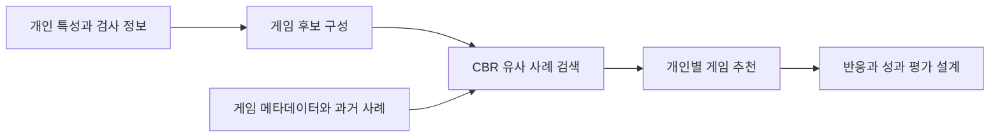

<a name="adhd-청소년-디지털-놀이치료-추천"></a>
<a name="adhd-청소년을-위한-디지털-놀이치료-추천"></a>
<a name="digital-play-therapy-algorithm-for-adhd-adolescent-patients"></a>

<a id="️-adhd-play-therapy-project"></a>

# ADHD Play Therapy Project

**유사사례를 바탕으로 디지털 놀이치료 콘텐츠를 추천하는 방법을 제안한 연구입니다.**

<!-- reading-levels17:start -->
| 읽기 수준 | 안내 내용 |
| --- | --- |
| [LEVEL 1 - Beginner](docs/%EC%9D%BD%EA%B8%B0%EC%95%88%EB%82%B4/%EB%A0%88%EB%B2%A81.md) | 낯선 용어를 풀고 입력부터 결과까지 구체적인 예로 읽기 |
| [LEVEL 2 - Explorer](docs/%EC%9D%BD%EA%B8%B0%EC%95%88%EB%82%B4/%EB%A0%88%EB%B2%A82.md) | 핵심 개념과 처리 흐름의 관계 이해 |
| [LEVEL 3 - Practitioner](docs/%EC%9D%BD%EA%B8%B0%EC%95%88%EB%82%B4/%EB%A0%88%EB%B2%A83.md) | 실험·사용 절차와 결과 해석 따라가기 |
| [LEVEL 4 - Advanced](docs/%EC%9D%BD%EA%B8%B0%EC%95%88%EB%82%B4/%EB%A0%88%EB%B2%A84.md) | 코드 구조·설정·설계 선택과 제약 검토 |
| [LEVEL 5 - Expert](docs/%EC%9D%BD%EA%B8%B0%EC%95%88%EB%82%B4/%EB%A0%88%EB%B2%A85.md) | 논문·프로토콜·분모·누수·미검증 범위 대조 |
<!-- reading-levels17:end -->

분야: 추천 시스템 › 사례 기반 추론 › 유사사례의 게임 추천

`논문·연구 자료` `Document`

[원고 읽기](#quick-start) · [저장소 구성](#structure) · [자료·설정](#data)

[핵심 구성](#input-processing-output)

<details>
<summary>원고 제목</summary>

Digital Play Therapy Algorithm for ADHD Adolescent Patients

</details>

<a id="-연구-핵심"></a>

## 연구 요약

CBR 기반 디지털 놀이치료 추천의 설계 원고입니다.

원고에는 정량 결과표와 임상 효과를 입증할 수 있는 참여자·통계 검정 결과가 제시되지 않습니다.

- 청소년 특성·게임 반응 사례를 검색·재사용하는 CBR 구성을 설명합니다.
- 개인화 추천을 통한 인지 능력 향상을 목표로 하며, 임상 효과 검증은 후속 과제입니다.

**자료별 안내:** [최종 원고](docs/versions/final-paper.md) · [전체 기록](docs/VERSIONS.md)

<a name="preview"></a>


[게재 논문 읽기](https://www.dbpia.co.kr/journal/articleDetail?nodeId=NODE12025366)

<a name="input-processing-output"></a>

<a id="-입력처리출력"></a>

## 입력·처리·출력

| 구분 | 내용 |
| --- | --- |
| 문제 | 청소년의 특성과 이전 게임 반응을 추천에 어떻게 반영할지 다룹니다. |
| 입력 | 나이·성별·게임·성과 등 사례 정보 |
| 처리 | 유사사례 검색과 CBR 추천 알고리즘 설계 |
| 출력 | 디지털 놀이치료 콘텐츠 추천 절차 |

---

<a id="-논문과-최신-자료"></a>

## 논문과 최신 자료

| 자료 | 원문 파일 |
| --- | --- |
| 최종 논문 · ADHD 놀이치료 | [게재 논문 읽기](https://www.dbpia.co.kr/journal/articleDetail?nodeId=NODE12025366) |

[자료별 설명](docs/PAPERS.md) · [코드 차수와 변경 이력](docs/REVISION_INDEX.md)

<a id="️-차수별-프로젝트-안내"></a>

## 전체 차수

| 차수·단계 | 주요 내용 | 자료 | 직전 비교 |
| --- | --- | --- | --- |
| <a id="layout18-table-4-row-1"></a> [최종 원고](docs/versions/final-paper.md) | 청소년의 특성과 게임 반응을 사례로 보관하고, 비슷한 사례를 이용해 디지털 놀이치료 게임을 추천하는 설계 연구입니다. | [폴더](%EB%85%BC%EB%AC%B8) | [전체 비교](docs/VERSIONS.md) |


<a id="-프로젝트-소개"></a>

## 연구 방법

저자: **곽윤석 · 김도연 · 박정수 · 안진호**

2024 한국정보기술학회 추계 종합학술대회 논문집, 인쇄쪽수 1727–1729. 학회 영문명은 **Korean Institute of Information Technology**입니다.

| 항목 | 원고에서 다루는 내용 |
| --- | --- |
| 사례 구성 | 나이·성별 등 특성, 게임 유형·플레이 기록, 인지 성과를 사례 항목으로 제안합니다. |
| 유사사례 검색 | 새 사용자의 특성을 기존 사례와 비교하여 추천 근거를 찾습니다. |
| 추천 흐름 | 게임 후보와 메타데이터를 결합하여 개인별 게임을 선택하는 흐름을 제시합니다. |
| 평가 설계 | 추천 이후 인지 능력 변화를 평가하는 절차를 제안합니다. |



<a name="structure"></a>
<a id="-저장소-구성"></a>

## 저장소 구성

```text
.
├── README.md
├── CHANGELOG.md
└── 논문/
    └── 최종_논문.pdf
```

- [게재 논문 읽기](https://www.dbpia.co.kr/journal/articleDetail?nodeId=NODE12025366)

<a id="-사례-기반-추천의-구성"></a>

## 사례 기반 추천의 구성

원고 2쪽은 사례 수집 → 유사성 평가 → 사례 검색 → 추천 적용 → 결과 평가의 순서를 설명합니다. 시스템 그림에는 MMSE 검사 결과, 게임 후보 생성, CBR 추천 모델과 게임 메타데이터가 연결되어 있습니다.

구체적인 유사도 수식이나 실행 가능한 추천 구현은 이 원고에 제시되지 않습니다.

<a name="quick-start"></a>
<a id="-원고-읽기"></a>

## 원고 읽기

1. 위의 최종 원고 링크를 엽니다.
2. 서론의 연구 질문과 방법을 먼저 읽습니다.
3. 알고리즘 구성도와 결론의 한계·후속 연구를 확인합니다. 이 원고에는 정량 결과표가 없습니다.

CBR 기반 디지털 놀이치료 콘텐츠 추천의 설계와 처리 흐름을 담은 연구 논문을 수록했습니다.

<a name="data"></a>
<a id="-자료-구성과-결과-해석"></a>

## 자료 구성과 결과 해석

사례 항목과 추천 절차를 중심으로 연구를 구성했습니다. 실제 환자 기록과 게임 이용 로그는 포함하지 않습니다.

<a name="원고가-보고한-결과와-한계"></a>

<a id="-원고가-보고한-결과와-한계"></a>

### 원고가 보고한 결과와 한계

기억력·집중력 훈련 게임 중 개인에게 맞는 후보를 찾는 것이 연구의 출발점입니다. 원고는 ADHD 환자와 정상 대조군의 특성·게임 반응을 사례로 수집하는 절차를 제안하지만, 실제 수집 표본이나 사례 데이터는 제공하지 않습니다.

CBR 기반 개인화를 통해 인지 능력 향상을 돕는 것을 목표로 합니다. 이 연구는 추천 구조의 설계 단계이며, 임상 참여자·대조군의 전후 평가와 통계 검정을 통한 치료 효과 검증은 후속 과제입니다.

<a id="-문제-해결"></a>

## 문제 해결

| 상황 | 확인할 내용 |
| --- | --- |
| 바로 실행할 프로그램이 보이지 않습니다. | 이 저장소의 중심 자료는 논문입니다.<br>연구 방법과 설계는 원고에서 확인할 수 있습니다. |
| 치료 효과 수치를 찾고 있습니다. | 원고는 추천 알고리즘 제안을 다루며 임상 효과 수치를 제공하지 않습니다. |
| 2025 폴더와 논문 연도가 다릅니다. | 원고 머리말의 학술 대회 연도는 2024년입니다.<br>보관 폴더 연도와 구분합니다. |

<a id="️-자료-폴더와-차수별-변화"></a>

## 자료 폴더와 차수별 변화

| 자료 | 자료 폴더 | 설명 | 비교·구성 |
| --- | --- | --- | --- |
| 최종 원고 | [자료 폴더](%EB%85%BC%EB%AC%B8) | [내용](docs/versions/final-paper.md) | [비교·구성](docs/VERSIONS.md) |

<a id="-현재-첨부-문서"></a>

## 최신 문서와 변경 이력

현재 제공하는 원문과 직전 공개본의 비교입니다. 이전 원고·발표와 코드는 전체 차수 표에서 확인할 수 있습니다.

| 문서 | 자료 폴더 | 상세 | 직전 공개본 전체 비교 |
| --- | --- | --- | --- |
| 최종 논문 · ADHD 놀이치료 | [폴더](%EB%85%BC%EB%AC%B8) | [설명](docs/latest/adhd-cbr-design.md) | [전체 비교](docs/changes/2026-11-02-%EC%B5%9C%EC%8B%A0%EB%AC%B8%EC%84%9C-%EC%A0%84%EC%B2%B4%EB%B9%84%EA%B5%90.md) |

[최신 문서 구성 변경](docs/changes/2026-11-02-%EC%B5%9C%EC%8B%A0%EB%AC%B8%EC%84%9C.md)

<a name="research-details"></a>

<a id="-연구구현의-세부-흐름"></a>

## 차수별 방법과 조건

차수별 입력, 처리 방법, 실행 조건과 결과를 정리했습니다.

<a id="️-최종-원고--사례로-찾는-디지털-놀이치료"></a>

<details>
<summary>최종 원고 · 사례로 찾는 디지털 놀이치료</summary>

### 최종 원고 · 사례로 찾는 디지털 놀이치료

청소년의 특성과 게임 반응을 사례로 보관하고, 비슷한 사례를 이용해 디지털 놀이치료 게임을 추천하는 설계 연구입니다.

| 구성 | 처리 내용 |
| --- | --- |
| 사례 구성 | 나이·성별 등 사용자 특성과 게임 유형·반응·성과를 한 사례로 연결합니다. |
| 사례 검색 | 새로운 사용자의 특성에 맞는 과거 사례를 찾아 추천 근거로 사용합니다. |
| 게임 후보 구성 | 게임 메타데이터와 이전 반응을 바탕으로 개인에게 맞는 콘텐츠를 선택하는 흐름을 설명합니다. |
| 추천 후 평가 | 게임 이용 이후 반응과 인지 성과를 관찰하고 다음 추천에 반영하는 설계를 제시합니다. |

| 입력·실행 조건 | 내용 |
| --- | --- |
| 자료 | 학술 대회 논문집의 3쪽 전체 원고 |
| 읽기 도구 | PDF 뷰어 |
| 사례 항목 | 연령·성별·게임 종류와 이용 반응 등 |
| 평가 범위 | 추천 구조와 평가 절차의 제안 |

이 자료의 결과는 추천 시스템의 설계와 처리 흐름입니다. 정량 성능 결과표나 참여자 수·대조군 비교·통계 검정으로 입증한 임상 효과는 원고에 제시되지 않습니다.

기억력·집중력 향상은 설계의 목표입니다.

실제 사용자 반응을 수집하고 추천 결과를 평가하려면 개인정보 보호와 연구 절차를 갖춘 별도의 실증이 필요합니다. 원고에 쓰인 목표를 이미측정된 치료 효과로 바꾸어 해석하지 않습니다.

| 제약 | 확인할 내용 |
| --- | --- |
| 추천을 바로 실행하고 싶을 때 | 유사도 수식·학습 데이터·실행 가능한 추천 서비스는 이 자료에 포함되지 않습니다. |
| 논문 연도를 확인할 때 | 원고의 학술 대회 표기는 2024년입니다.<br>컴퓨터의 보관 연도와 구분합니다. |
| 효과 수치를 인용할 때 | 이 원고는 설계 제안이며 치료 전후의 정량 실험 결과를 제공하지 않습니다. |

[파일 구성·핵심 정의·사용 순서](docs/versions/final-paper.md) · [이 단계 전체 비교](docs/VERSIONS.md)

[차수별 안내 변경](docs/changes/2026-11-03-%EC%B0%A8%EC%88%98%EB%B3%84%ED%94%84%EB%A1%9C%EC%A0%9D%ED%8A%B8%EC%95%88%EB%82%B4.md)

</details>
