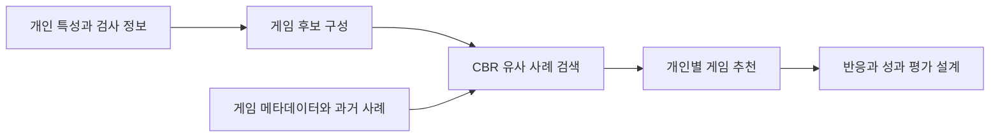

<div align="center">

<a name="adhd-청소년-디지털-놀이치료-추천"></a>
<a name="adhd-청소년을-위한-디지털-놀이치료-추천"></a>
<a name="digital-play-therapy-algorithm-for-adhd-adolescent-patients"></a>

# 🕹️ ADHD Play Therapy Project

유사 사례를 바탕으로 디지털 놀이치료 콘텐츠를 추천하는 방법을 제안한 연구입니다.

**기술 분류:** 추천 시스템 › 사례 기반 추론 › 유사 사례의 게임 추천

`논문·연구 자료` `Document`

[원고 읽기](#quick-start) · [저장소 구성](#structure) · [자료·설정](#data)

[핵심 구성](#input-processing-output)

<details>
<summary>📄 원고 제목</summary>

Digital Play Therapy Algorithm for ADHD Adolescent Patients

</details>

</div>

<a name="overview"></a>

## ✨ 최종 원고에서 살펴볼 점

CBR 기반 디지털 놀이치료 추천의 설계 원고입니다.

원고에는 정량 결과표와 임상 효과를 입증할 수 있는 참여자·통계 검정 결과가 제시되지 않습니다.

- 청소년 특성·게임 반응 사례를 검색·재사용하는 CBR 구성을 설명합니다.
- 결론의 기대 효과와 임상 효과 입증을 구분합니다. 참여자·대조군·정량 검정 결과가 제공되지 않아 효과를 재현할 수 없습니다.

**자료별 안내:** [최종 원고](docs/versions/final-paper.md) · [전체 기록](docs/VERSIONS.md)

<a name="preview"></a>

<details>
<summary>📎 논문 도표와 출처</summary>

[📊 원고 도표 보기](assets/previews/paper-architecture.png)

**논문 그림** — 공개 원고 2쪽 그림 1: CBR 기반 디지털 놀이치료 추천 시스템 구조입니다.

[근거 파일 보기](%EB%85%BC%EB%AC%B8/%EC%B5%9C%EC%A2%85_%EB%85%BC%EB%AC%B8.pdf)

</details>

<a name="input-processing-output"></a>

## 🔄 입력·처리·출력

| 단계 | 이 프로젝트에서 다루는 내용 |
| :--- | :--- |
| 📥 입력 | 나이·성별·게임·성과 등 사례 정보 |
| ⚙️ 처리 | 유사 사례 검색과 CBR 추천 알고리즘 설계 |
| 📤 출력 | 디지털 놀이치료 콘텐츠 추천 절차 |


---

## ✨ 프로젝트 소개

저자: **곽윤석 · 김도연 · 박정수 · 안진호**

2024 한국정보기술학회 추계 종합학술대회 논문집, 인쇄쪽수 1727–1729. 학회 영문명은 **Korean Institute of Information Technology**입니다.

| 항목 | 원고에서 다루는 내용 |
|---|---|
| 사례 구성 | 나이·성별 등 특성, 게임 유형·플레이 기록, 인지 성과를 사례 항목으로 제안합니다. |
| 유사 사례 검색 | 새 사용자의 특성을 기존 사례와 비교하여 추천 근거를 찾습니다. |
| 추천 흐름 | 게임 후보와 메타데이터를 결합하여 개인별 게임을 선택하는 흐름을 제시합니다. |
| 평가 설계 | 추천 이후 인지 능력 변화를 평가하는 절차를 제안합니다. |



<a name="structure"></a>
## 📁 저장소 구성

```text
.
├── README.md
├── CHANGELOG.md
└── 논문/
    └── 최종_논문.pdf
```

- [전체 최종 원고](논문/최종_논문.pdf)

## 🧩 사례 기반 추천의 구성

원고 2쪽은 사례 수집 → 유사성 평가 → 사례 검색 → 추천 적용 → 결과 평가의 순서를 설명합니다. 시스템 그림에는 MMSE 검사결과, 게임 후보 생성, CBR 추천 모델과 게임 메타데이터가 연결되어 있습니다. 구체적인 유사도 수식이나 실행 가능한 추천 구현은 이 원고에 제시되지 않습니다.

<a name="quick-start"></a>
## 🚀 원고 읽기

1. 위의 최종 원고 링크를 엽니다.
2. 서론의 연구 질문과 방법을 먼저 읽습니다.
3. 알고리즘 구성도와 결론의 한계·후속 연구를 확인합니다. 이 원고에는 정량 결과표가 없습니다.

이 저장소에는 실행 코드가 없어 원고를 내려받아 읽으면 됩니다. 기존 원본 폴더 조사에서도 지정한 코드 확장자의 일반 파일은 찾지 못했습니다. 다만 압축 파일 내부까지 조사한 것은 아닙니다.

<a name="data"></a>
## 📊 자료 구성과 결과 해석

실제 환자 기록이나 게임 이용 로그는 포함하지 않습니다. 원고가 설명하는 사례 항목은 연구 설계이며 공개 환자 데이터셋을 제공한다는 의미가 아닙니다.

<a name="원고가-보고한-결과와-한계"></a>

### 🔎 원고가 보고한 결과와 한계

기억력·집중력 훈련 게임 중 개인에게 맞는 후보를 찾는 것이 연구의 출발점입니다. 원고는 ADHD 환자와 정상 대조군의 특성·게임 반응을 사례로 수집하는 절차를 제안하지만, 실제 수집 표본이나 사례 데이터는 제공하지 않습니다.

결론에는 인지 능력 향상 가능성을 확인했다는 표현이 있습니다. 다만 원고는 CBR 기반 개인화의 설계를 제시하는 단계로 읽어야 합니다. 임상 참여자 수, 대조군 배정, 전후 평가 수치나 통계 검정 결과가 제시되어 있지 않으므로 치료 효과를 실증한 자료로 해석하지 않습니다.

## 🛠 문제 해결

| 상황 | 확인할 내용 |
|---|---|
| 바로 실행할 프로그램이 보이지 않습니다. | 이 저장소의 중심 자료는 논문입니다. 실행 코드가 포함되었다고 안내하지 않습니다. |
| 치료 효과 수치를 찾고 있습니다. | 원고는 추천 알고리즘 제안을 다루며 임상 효과 수치를 제공하지 않습니다. |
| 2025 폴더와 논문 연도가 다릅니다. | 원고 머리말의 학술대회 연도는 2024년입니다. 보관 폴더 연도와 구분합니다. |

<div align="center">

연구 방법과 결과, 다음에 확인할 과제를 함께 살펴볼 수 있습니다.

</div>
