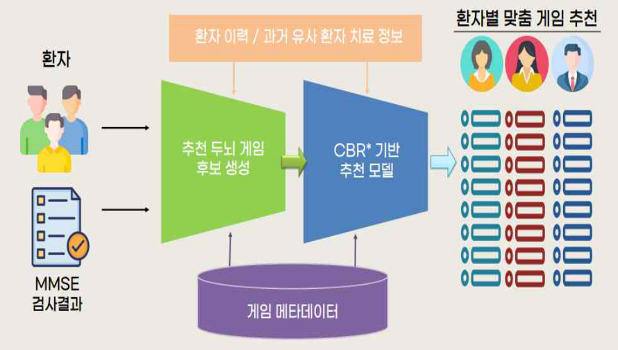
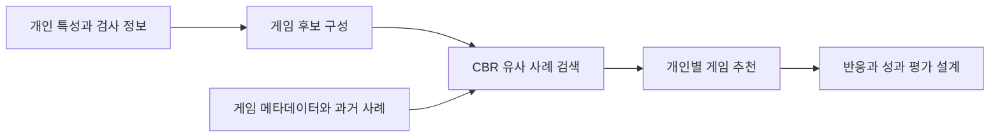

# ADHD-Play-Therapy-Project — LEVEL 2 - Explorer

**읽기 수준 선택** · [LEVEL 1 - Beginner](%EB%A0%88%EB%B2%A81.md) · **LEVEL 2 - Explorer** · [LEVEL 3 - Practitioner](%EB%A0%88%EB%B2%A83.md) · [LEVEL 4 - Advanced](%EB%A0%88%EB%B2%A84.md) · [LEVEL 5 - Expert](%EB%A0%88%EB%B2%A85.md)

[같은 수준 프로필](https://github.com/PUVKID/PUVKID/blob/main/docs/읽기안내/레벨2.md) · [저장소 첫 화면](../../README.md)

<a id="guide-intro"></a>

## 프로젝트 소개

**핵심 개념은 사례 기반 추론(CBR)입니다.** 새 상황을 처음부터 규칙으로 풀기보다 기존 사례와의 유사성을 이용합니다. 이 원고에서는 청소년의 특성·게임 경험·성과를 사례로 연결하고, 검색한 사례를 게임 추천과 후속 평가에 재사용하는 구조를 설명합니다.

<a id="guide-problem"></a>

## 문제와 주요 기능

사례에는 연령·성별 같은 특성뿐 아니라 게임 종류와 이용 반응도 연결됩니다. 게임을 단순 목록으로 고르는 문제에서, 어떤 사용자에게 어떤 게임이 맞을지 과거 자료로 판단하는 문제로 바뀝니다. 기억력·집중력 향상은 이 설계가 지향하는 목표입니다.

<a id="guide-flow"></a>

## 입력·처리·출력

사례 수집 → 유사성 평가 → 사례 검색 → 추천 적용 → 결과 평가로 이어집니다. 시스템 그림에는 MMSE 검사결과, 게임 후보 생성, CBR 추천 모델과 게임 메타데이터가 연결됩니다. 각 화살표가 어떤 정보를 넘기는지 구분하면 전체 흐름을 읽기 쉽습니다.

<a id="guide-practice"></a>

## 실험과 사용 흐름

원고의 CBR 설명을 읽은 다음 시스템 구조도에서 사례 저장·검색·후보 추천·평가를 찾아봅니다. 이후 결론에서 제안한 활용 방향과 아직 필요한 실증을 구분합니다. 논문의 보관 폴더 연도와 학술대회 표기는 별개입니다.

<a id="guide-results"></a>

## 관측 결과와 해석

방법의 산출물은 개인별 디지털 게임 후보를 선택하는 절차입니다. 참여자 수, 대조군 비교, 통계 검정으로 확인한 임상 결과는 원고에 없습니다. 설계 목표와 관측 결과를 나누어 읽어야 합니다.

<a id="guide-architecture"></a>

## 구현과 핵심 파일

저장소는 논문 원문, 전체 차수 안내, 자료별 해설로 구성됩니다. 추천 앱의 함수나 모델 가중치를 담은 구조가 아닙니다. 그림과 입출력 표를 함께 보면 원고가 설명하는 모듈 관계를 파악할 수 있습니다.

<a id="guide-paper"></a>

## 실제 논문과 원고

원고의 영문 제목은 Digital Play Therapy Algorithm for ADHD Adolescent Patients입니다. 인쇄쪽수는 1727–1729이며 학회 영문명은 Korean Institute of Information Technology입니다. 서지 정보와 연구의 제안 범위를 함께 확인합니다.

<a id="guide-limits"></a>

## 조건·실패·미검증 한계

게임 추천 구조를 이해할 수 있지만 추천에 쓰는 구체적인 유사도 수식과 실행 서비스는 없습니다. 개인정보 보호와 연구 절차를 갖춘 실증이 후속 과제입니다. 자료가 없는 부분을 좋은 결과가 나온 부분으로 해석하지 않습니다.

## 전체 차수

차수는 아래의 실제 자료 구분을 따릅니다. 설명은 현재 선택한 수준으로 열리며, 자료 폴더와 당시 전체 비교도 함께 확인할 수 있습니다.

| 차수·단계 · 같은 수준 설명 · 자료 폴더 · 직전 비교·구성 |
| --- |
| **차수·단계**<br>최종 원고<br><br>**같은 수준 설명**<br>[LEVEL 2 - Explorer](../versions/final-paper.md#reading-level-2)<br><br>**자료 폴더**<br>[자료](../../%EB%85%BC%EB%AC%B8)<br><br>**직전 비교·구성**<br>[전체 비교](../VERSIONS.md) |

## 첫 화면의 모든 설명과 공통 근거

아래는 기존 첫 화면의 실질 구성 전체입니다. 각 항목의 개념은 이 페이지의 풀이와 연결하고, 실제 표·코드·그림·상세 조건은 원문 공통 근거에서 확인합니다. 기존 전체 비교는 문장·주석·파일 단위의 작은 변화까지 보존하는 자료입니다.

| 첫 화면 구성 · 이 수준의 풀이 · 원문 공통 근거 |
| --- |
| **첫 화면 구성**<br>연구 요약<br><br>**이 수준의 풀이**<br>[프로젝트 소개](#guide-intro)<br><br>**원문 공통 근거**<br>[전체 설명·표·그림](../../README.md#-%EC%97%B0%EA%B5%AC-%ED%95%B5%EC%8B%AC) |
| **첫 화면 구성**<br>입력·처리·출력<br><br>**이 수준의 풀이**<br>[MMSE·개인 특성·게임 정보가 연결되는 방식](#semantic-cases-level-2)<br><br>**원문 공통 근거**<br>[전체 설명·표·그림](../../README.md#-%EC%9E%85%EB%A0%A5%EC%B2%98%EB%A6%AC%EC%B6%9C%EB%A0%A5) |
| **첫 화면 구성**<br>논문과 최신 자료<br><br>**이 수준의 풀이**<br>[전체 원고를 확인하는 순서와 자료 범위](#semantic-paper-level-2)<br><br>**원문 공통 근거**<br>[전체 설명·표·그림](../../README.md#-%EB%85%BC%EB%AC%B8%EA%B3%BC-%EC%B5%9C%EC%8B%A0-%EC%9E%90%EB%A3%8C) |
| **첫 화면 구성**<br>전체 차수<br><br>**이 수준의 풀이**<br>[문제와 주요 기능](#guide-problem)<br><br>**원문 공통 근거**<br>[전체 설명·표·그림](../../README.md#%EF%B8%8F-%EC%B0%A8%EC%88%98%EB%B3%84-%ED%94%84%EB%A1%9C%EC%A0%9D%ED%8A%B8-%EC%95%88%EB%82%B4) |
| **첫 화면 구성**<br>연구 방법<br><br>**이 수준의 풀이**<br>[MMSE·개인 특성·게임 정보가 연결되는 방식](#semantic-cases-level-2)<br><br>**원문 공통 근거**<br>[전체 설명·표·그림](../../README.md#-%ED%94%84%EB%A1%9C%EC%A0%9D%ED%8A%B8-%EC%86%8C%EA%B0%9C) |
| **첫 화면 구성**<br>저장소 구성<br><br>**이 수준의 풀이**<br>[구현과 핵심 파일](#guide-architecture)<br><br>**원문 공통 근거**<br>[전체 설명·표·그림](../../README.md#-%EC%A0%80%EC%9E%A5%EC%86%8C-%EA%B5%AC%EC%84%B1) |
| **첫 화면 구성**<br>사례 기반 추천의 구성<br><br>**이 수준의 풀이**<br>[MMSE·개인 특성·게임 정보가 연결되는 방식](#semantic-cases-level-2)<br><br>**원문 공통 근거**<br>[전체 설명·표·그림](../../README.md#-%EC%82%AC%EB%A1%80-%EA%B8%B0%EB%B0%98-%EC%B6%94%EC%B2%9C%EC%9D%98-%EA%B5%AC%EC%84%B1) |
| **첫 화면 구성**<br>원고 읽기<br><br>**이 수준의 풀이**<br>[전체 원고를 확인하는 순서와 자료 범위](#semantic-paper-level-2)<br><br>**원문 공통 근거**<br>[전체 설명·표·그림](../../README.md#-%EC%9B%90%EA%B3%A0-%EC%9D%BD%EA%B8%B0) |
| **첫 화면 구성**<br>자료 구성과 결과 해석<br><br>**이 수준의 풀이**<br>[추천 후 평가와 아직 제시되지 않은 성과](#semantic-evaluation-level-2)<br><br>**원문 공통 근거**<br>[전체 설명·표·그림](../../README.md#-%EC%9E%90%EB%A3%8C-%EA%B5%AC%EC%84%B1%EA%B3%BC-%EA%B2%B0%EA%B3%BC-%ED%95%B4%EC%84%9D) |
| **첫 화면 구성**<br>문제 해결<br><br>**이 수준의 풀이**<br>[전체 원고를 확인하는 순서와 자료 범위](#semantic-paper-level-2)<br><br>**원문 공통 근거**<br>[전체 설명·표·그림](../../README.md#-%EB%AC%B8%EC%A0%9C-%ED%95%B4%EA%B2%B0) |
| **첫 화면 구성**<br>자료 폴더와 차수별 변화<br><br>**이 수준의 풀이**<br>[문제와 주요 기능](#guide-problem)<br><br>**원문 공통 근거**<br>[전체 설명·표·그림](../../README.md#%EF%B8%8F-%EC%9E%90%EB%A3%8C-%ED%8F%B4%EB%8D%94%EC%99%80-%EC%B0%A8%EC%88%98%EB%B3%84-%EB%B3%80%ED%99%94) |
| **첫 화면 구성**<br>최신 문서와 변경 이력<br><br>**이 수준의 풀이**<br>[전체 원고를 확인하는 순서와 자료 범위](#semantic-paper-level-2)<br><br>**원문 공통 근거**<br>[전체 설명·표·그림](../../README.md#-%ED%98%84%EC%9E%AC-%EC%B2%A8%EB%B6%80-%EB%AC%B8%EC%84%9C) |
| **첫 화면 구성**<br>차수별 방법과 조건<br><br>**이 수준의 풀이**<br>[추천 후 평가와 아직 제시되지 않은 성과](#semantic-evaluation-level-2)<br><br>**원문 공통 근거**<br>[전체 설명·표·그림](../../README.md#-%EC%97%B0%EA%B5%AC%EA%B5%AC%ED%98%84%EC%9D%98-%EC%84%B8%EB%B6%80-%ED%9D%90%EB%A6%84) |

## 이어 읽기

같은 난이도로 다른 프로젝트를 찾으려면 [프로필의 LEVEL 2 - Explorer](https://github.com/PUVKID/PUVKID/blob/main/docs/읽기안내/레벨2.md)를 엽니다. 이 저장소 안에서는 위 전체 차수 표의 같은 수준 설명으로 이동하세요. 단계별 선택표에서 깊이를 바꿀 수 있으며, LEVEL 5 아래에는 기존 상세 전체가 보존되어 있습니다.

<!-- semantic-explanation17:start -->

## LEVEL 2 · 조건과 절차를 상세히 읽기

<a id="semantic-cases-level-2"></a>

### LEVEL 2 · MMSE·개인 특성·게임 정보가 연결되는 방식

개인 특성과 검사정보는 어떤 후보를 만들지,게임 메타데이터와 과거 반응은 어떤 사례가 닮았는지를 살피는 쪽에 연결됩니다.CBR은 이 관계를 재사용하는 설계입니다.추천 뒤 평가가 새 사례로 돌아가는 흐름까지 함께 봐야 합니다.

<a id="layout18-table-3-row-1"></a>

**사례의 구성**

**조건·자료**

사례의 구성

**의미와 확인 방법**

나이·성별 등 특성,게임 유형·플레이 기록·반응과 인지 성과를 한 사례로 연결하는 제안입니다.실제 환자 기록이나 이용 로그를 제공하는 데이터베이스는 아닙니다.

<a id="layout18-table-3-row-2"></a>

**MMSE 검사결과와 후보 생성**

**조건·자료**

MMSE 검사결과와 후보 생성

**의미와 확인 방법**

원고2쪽 시스템 그림은 MMSE라는 검사 결과 정보와 개인 특성을 게임 후보 생성에 연결합니다.검사 점수만으로 ADHD 진단이나 치료 결정을 내리는 구현을 제공하지 않습니다.

<a id="layout18-table-3-row-3"></a>

**게임 메타데이터**

**조건·자료**

게임 메타데이터

**의미와 확인 방법**

메타데이터는 게임 종류와 같은 게임을 설명하는 부가정보입니다.과거 사례와 함께 CBR 추천 모델에 들어가 개인별 후보 선택의 근거가 되는 구조입니다.

<a id="layout18-table-3-row-4"></a>

**사례 기반 추론 CBR**

**조건·자료**

사례 기반 추론 CBR

**의미와 확인 방법**

과거의 비슷한 사례를 찾아 새 추천에 참고하는 접근입니다.원고 순서는 사례 수집→유사성 평가→사례 검색→추천 적용→결과 평가입니다.


<a id="semantic-evaluation-level-2"></a>

### LEVEL 2 · 추천 후 평가와 아직 제시되지 않은 성과

추천을 적용한 뒤 반응을 수집하면 다음 사례를 더 풍부하게 만들 수 있다는 구상입니다.그러나 원고는 그 순환이 실제로 얼마나 효과적인지 보여 주는 표본·수치·검정을 제시하지 않습니다.설계의 연결과 효과 입증을 나누어 읽습니다.

<a id="layout18-table-4-row-1"></a>

**연구 목표**

**조건·자료**

연구 목표

**의미와 확인 방법**

기억력·집중력 훈련 게임 중 개인에게 맞는 후보를 찾고 인지 능력 향상을 돕는 것이 목표입니다.목표를 이미 관측한 개선 성과로 바꾸지 않습니다.

<a id="layout18-table-4-row-2"></a>

**ADHD·대조군 사례 수집 제안**

**조건·자료**

ADHD·대조군 사례 수집 제안

**의미와 확인 방법**

환자와 정상 대조군의 특성·게임 반응을 수집하는 절차를 제안합니다.실제 참여자 수·수집 표본·사례 데이터는 제공하지 않습니다.

<a id="layout18-table-4-row-3"></a>

**추천 이후의 평가**

**조건·자료**

추천 이후의 평가

**의미와 확인 방법**

이용 반응과 인지 성과를 관찰해 다음 추천에 반영하는 설계입니다.치료 전후 비교·대조군 실험·통계검정을 수행한 효과 검증은 후속 과제입니다.

<a id="layout18-table-4-row-4"></a>

**구현·결과 부재**

**조건·자료**

구현·결과 부재

**의미와 확인 방법**

정량 성능표·구체 유사도 수식·학습 데이터·실행 가능한 추천 서비스는 원고에 없습니다.임의의 계산식이나 임상 수치를 새로 만들어 보완하지 않습니다.


<a id="semantic-paper-level-2"></a>

### LEVEL 2 · 전체 원고를 확인하는 순서와 자료 범위

첫 화면 그림은 원고2쪽의 시스템 구조를 보여 주는 길잡이입니다.전체 원고에서 연구 질문과 후속평가까지 연결해 읽으면 설계의 목적과 한계가 이어집니다.자료 보관 구분을 새 실험 차수로 세지 않습니다.

<a id="layout18-table-5-row-1"></a>

**발표와 전체 분량**

**조건·자료**

발표와 전체 분량

**의미와 확인 방법**

2024 한국정보기술학회 추계 종합학술대회 논문집1727–1729의3쪽 원고입니다.학회 영문명은 Korean Institute of Information Technology이며 보관폴더 연도와 발표연도는 다를 수 있습니다.

<a id="layout18-table-5-row-2"></a>

**읽는 순서**

**조건·자료**

읽는 순서

**의미와 확인 방법**

PDF뷰어로 서론의 질문→2쪽 시스템 그림→알고리즘 순서→결론의 한계/후속연구를 확인합니다.정량 결과표는 없습니다.

<a id="layout18-table-5-row-3"></a>

**공개 자료의 역할**

**조건·자료**

공개 자료의 역할

**의미와 확인 방법**

중심자료는 최종 논문 PDF와 원고 그림입니다.실제 게임 실행파일·환자기록·게임로그·추천 서비스 설치패키지는 포함하지 않습니다.자료 차수는 단일 최종 원고로 안내합니다.


<!-- semantic-explanation17:end -->

<!-- complete-source-facts17:start -->

## 첫 화면의 세부 사실을 빠짐없이 읽기

위의 수준별 풀이에 대응하는 실제 세부 사실입니다. 입력·조건·수치·표·그림·문서 판본과 작은 변경까지 같은 페이지에서 확인하도록 기존 첫 화면의 내용을 함께 수록했습니다. 각 절은 해당 수준의 앞선 설명과 연결해 읽으며, 원래 실행 코드·전체 비교·원고는 원문 주소로 이어집니다.

<a id="facts-section-0"></a>

### LEVEL 2 · 첫 화면 기본 정보


유사 사례를 바탕으로 디지털 놀이치료 콘텐츠를 추천하는 방법을 제안한 연구입니다.

분야: 추천 시스템 › 사례 기반 추론 › 유사 사례의 게임 추천

`논문·연구 자료` `Document`

[원고 읽기](../../README.md#quick-start) · [저장소 구성](../../README.md#structure) · [자료·설정](../../README.md#data)

[핵심 구성](../../README.md#input-processing-output)

<details>
<summary>원고 제목</summary>

Digital Play Therapy Algorithm for ADHD Adolescent Patients

</details>


<a id="facts-section-1"></a>

### LEVEL 2 · 연구 요약


CBR 기반 디지털 놀이치료 추천의 설계 원고입니다.

원고에는 정량 결과표와 임상 효과를 입증할 수 있는 참여자·통계 검정 결과가 제시되지 않습니다.

- 청소년 특성·게임 반응 사례를 검색·재사용하는 CBR 구성을 설명합니다.
- 개인화 추천을 통한 인지 능력 향상을 목표로 하며, 임상 효과 검증은 후속 과제입니다.

**자료별 안내:** [최종 원고](../../docs/versions/final-paper.md#reading-level-2) · [전체 기록](../../docs/VERSIONS.md)




**논문 그림** — 공개 원고 2쪽 그림 1: CBR 기반 디지털 놀이치료 추천 시스템 구조입니다.

[근거 파일 보기](../../%EB%85%BC%EB%AC%B8/%EC%B5%9C%EC%A2%85_%EB%85%BC%EB%AC%B8.pdf)


<a id="facts-section-2"></a>

### LEVEL 2 · 입력·처리·출력


**구분**

문제

**내용**

청소년의 특성과 이전 게임 반응을 추천에 어떻게 반영할지 다룹니다.


**구분**

입력

**내용**

나이·성별·게임·성과 등 사례 정보


**구분**

처리

**내용**

유사 사례 검색과 CBR 추천 알고리즘 설계


**구분**

출력

**내용**

디지털 놀이치료 콘텐츠 추천 절차


---


<a id="facts-section-3"></a>

### LEVEL 2 · 논문과 최신 자료


| 자료 · 원문 파일 |
| --- |
| **자료**<br>최종 논문 · ADHD 놀이치료<br><br>**원문 파일**<br>[PDF 다운로드](../../%EB%85%BC%EB%AC%B8/%EC%B5%9C%EC%A2%85_%EB%85%BC%EB%AC%B8.pdf) |

[자료별 설명](../../docs/PAPERS.md) · [코드 차수와 변경 이력](../../docs/REVISION_INDEX.md)


<a id="facts-section-4"></a>

### LEVEL 2 · 전체 차수


<a id="layout18-table-8-row-1"></a>

**[최종 원고](../../docs/versions/final-paper.md#reading-level-2)**

**차수·단계**

[최종 원고](../../docs/versions/final-paper.md#reading-level-2)

**주요 내용**

청소년의 특성과 게임 반응을 사례로 보관하고, 비슷한 사례를 이용해 디지털 놀이치료 게임을 추천하는 설계 연구입니다.

**자료**

[폴더](../../%EB%85%BC%EB%AC%B8)

**직전 비교**

[전체 비교](../../docs/VERSIONS.md)


<a id="facts-section-5"></a>

### LEVEL 2 · 연구 방법


저자: **곽윤석 · 김도연 · 박정수 · 안진호**

2024 한국정보기술학회 추계 종합학술대회 논문집, 인쇄쪽수 1727–1729. 학회 영문명은 **Korean Institute of Information Technology**입니다.

**항목**

사례 구성

**원고에서 다루는 내용**

나이·성별 등 특성, 게임 유형·플레이 기록, 인지 성과를 사례 항목으로 제안합니다.


**항목**

유사 사례 검색

**원고에서 다루는 내용**

새 사용자의 특성을 기존 사례와 비교하여 추천 근거를 찾습니다.


**항목**

추천 흐름

**원고에서 다루는 내용**

게임 후보와 메타데이터를 결합하여 개인별 게임을 선택하는 흐름을 제시합니다.


**항목**

평가 설계

**원고에서 다루는 내용**

추천 이후 인지 능력 변화를 평가하는 절차를 제안합니다.





<a id="facts-section-6"></a>

### LEVEL 2 · 저장소 구성


```text
.
├── README.md
├── CHANGELOG.md
└── 논문/
    └── 최종_논문.pdf
```

- [전체 최종 원고](../../논문/최종_논문.pdf)


<a id="facts-section-7"></a>

### LEVEL 2 · 사례 기반 추천의 구성


원고 2쪽은 사례 수집 → 유사성 평가 → 사례 검색 → 추천 적용 → 결과 평가의 순서를 설명합니다. 시스템 그림에는 MMSE 검사결과, 게임 후보 생성, CBR 추천 모델과 게임 메타데이터가 연결되어 있습니다.

구체적인 유사도 수식이나 실행 가능한 추천 구현은 이 원고에 제시되지 않습니다.


<a id="facts-section-8"></a>

### LEVEL 2 · 원고 읽기


1. 위의 최종 원고 링크를 엽니다.
2. 서론의 연구 질문과 방법을 먼저 읽습니다.
3. 알고리즘 구성도와 결론의 한계·후속 연구를 확인합니다. 이 원고에는 정량 결과표가 없습니다.

CBR 기반 디지털 놀이치료 콘텐츠 추천의 설계와 처리 흐름을 담은 연구 논문을 수록했습니다.


<a id="facts-section-9"></a>

### LEVEL 2 · 자료 구성과 결과 해석


사례 항목과 추천 절차를 중심으로 연구를 구성했습니다. 실제 환자 기록과 게임 이용 로그는 포함하지 않습니다.


#### LEVEL 2 · 원고가 보고한 결과와 한계

기억력·집중력 훈련 게임 중 개인에게 맞는 후보를 찾는 것이 연구의 출발점입니다. 원고는 ADHD 환자와 정상 대조군의 특성·게임 반응을 사례로 수집하는 절차를 제안하지만, 실제 수집 표본이나 사례 데이터는 제공하지 않습니다.

CBR 기반 개인화를 통해 인지 능력 향상을 돕는 것을 목표로 합니다. 이 연구는 추천 구조의 설계 단계이며, 임상 참여자·대조군의 전후 평가와 통계 검정을 통한 치료 효과 검증은 후속 과제입니다.


<a id="facts-section-10"></a>

### LEVEL 2 · 문제 해결


**상황**

바로 실행할 프로그램이 보이지 않습니다.

**확인할 내용**

이 저장소의 중심 자료는 논문입니다. 연구 방법과 설계는 원고에서 확인할 수 있습니다.


**상황**

치료 효과 수치를 찾고 있습니다.

**확인할 내용**

원고는 추천 알고리즘 제안을 다루며 임상 효과 수치를 제공하지 않습니다.


**상황**

2025 폴더와 논문 연도가 다릅니다.

**확인할 내용**

원고 머리말의 학술대회 연도는 2024년입니다. 보관 폴더 연도와 구분합니다.


<a id="facts-section-11"></a>

### LEVEL 2 · 자료 폴더와 차수별 변화


| 자료 · 자료 폴더 · 설명 · 비교·구성 |
| --- |
| **자료**<br>최종 원고<br><br>**자료 폴더**<br>[자료 폴더](../../%EB%85%BC%EB%AC%B8)<br><br>**설명**<br>[내용](../../docs/versions/final-paper.md#reading-level-2)<br><br>**비교·구성**<br>[비교·구성](../../docs/VERSIONS.md) |


<a id="facts-section-12"></a>

### LEVEL 2 · 최신 문서와 변경 이력


현재 제공하는 원문과 직전 공개본의 비교입니다. 이전 원고·발표와 코드는 전체 차수 표에서 확인할 수 있습니다.

| 문서 · 자료 폴더 · 상세 · 직전 공개본 전체 비교 |
| --- |
| **문서**<br>최종 논문 · ADHD 놀이치료<br><br>**자료 폴더**<br>[폴더](../../%EB%85%BC%EB%AC%B8)<br><br>**상세**<br>[설명](../../docs/latest/adhd-cbr-design.md)<br><br>**직전 공개본 전체 비교**<br>[전체 비교](../../docs/changes/2026-11-02-%EC%B5%9C%EC%8B%A0%EB%AC%B8%EC%84%9C-%EC%A0%84%EC%B2%B4%EB%B9%84%EA%B5%90.md) |

[최신 문서 구성 변경](../../docs/changes/2026-11-02-%EC%B5%9C%EC%8B%A0%EB%AC%B8%EC%84%9C.md)


<a id="facts-section-13"></a>

### LEVEL 2 · 차수별 방법과 조건


차수별 입력, 처리 방법, 실행 조건과 결과를 정리했습니다.


<details>
<summary>최종 원고 · 사례로 찾는 디지털 놀이치료</summary>

#### LEVEL 2 · 최종 원고 · 사례로 찾는 디지털 놀이치료

청소년의 특성과 게임 반응을 사례로 보관하고, 비슷한 사례를 이용해 디지털 놀이치료 게임을 추천하는 설계 연구입니다.

**구성**

사례 구성

**처리 내용**

나이·성별 등 사용자 특성과 게임 유형·반응·성과를 한 사례로 연결합니다.


**구성**

사례 검색

**처리 내용**

새로운 사용자의 특성에 맞는 과거 사례를 찾아 추천 근거로 사용합니다.


**구성**

게임 후보 구성

**처리 내용**

게임 메타데이터와 이전 반응을 바탕으로 개인에게 맞는 콘텐츠를 선택하는 흐름을 설명합니다.


**구성**

추천 후 평가

**처리 내용**

게임 이용 이후 반응과 인지 성과를 관찰하고 다음 추천에 반영하는 설계를 제시합니다.


**입력·실행 조건**

자료

**내용**

학술대회 논문집의 3쪽 전체 원고


**입력·실행 조건**

읽기 도구

**내용**

PDF 뷰어


**입력·실행 조건**

사례 항목

**내용**

연령·성별·게임 종류와 이용 반응 등


**입력·실행 조건**

평가 범위

**내용**

추천 구조와 평가 절차의 제안


이 자료의 결과는 추천 시스템의 설계와 처리 흐름입니다. 정량 성능 결과표나 참여자 수·대조군 비교·통계 검정으로 입증한 임상 효과는 원고에 제시되지 않습니다.

기억력·집중력 향상은 설계의 목표입니다.

실제 사용자 반응을 수집하고 추천 결과를 평가하려면 개인정보 보호와 연구 절차를 갖춘 별도의 실증이 필요합니다. 원고에 쓰인 목표를 이미 측정된 치료 효과로 바꾸어 해석하지 않습니다.

**제약**

추천을 바로 실행하고 싶을 때

**확인할 내용**

유사도 수식·학습 데이터·실행 가능한 추천 서비스는 이 자료에 포함되지 않습니다.


**제약**

논문 연도를 확인할 때

**확인할 내용**

원고의 학술대회 표기는 2024년입니다. 컴퓨터의 보관 연도와 구분합니다.


**제약**

효과 수치를 인용할 때

**확인할 내용**

이 원고는 설계 제안이며 치료 전후의 정량 실험 결과를 제공하지 않습니다.


[파일 구성·핵심 정의·사용 순서](../../docs/versions/final-paper.md#reading-level-2) · [이 단계 전체 비교](../../docs/VERSIONS.md)

[차수별 안내 변경](../../docs/changes/2026-11-03-%EC%B0%A8%EC%88%98%EB%B3%84%ED%94%84%EB%A1%9C%EC%A0%9D%ED%8A%B8%EC%95%88%EB%82%B4.md)

</details>


<!-- complete-source-facts17:end -->

## 구조도와 서지를 이 수준에서 해석하기

**개념의 연결:** MMSE 검사결과와 개인 특성은 사용자 쪽 입력이고 게임 메타데이터는 후보를 구성하는 게임 쪽 정보입니다. 후보 생성 뒤 CBR 모델이 기존 사례를 검색해 개인별 게임을 연결하는 구조를 제시합니다. CBR의 사례에는 사용자 특성뿐 아니라 게임 이용 반응과 성과도 함께 묶입니다.

사례 수집→유사성 평가→사례 검색→추천 적용→결과 평가는 입력 정리, 비교, 검색, 선택, 사후 평가를 각각 구분한 순서입니다. 유사성 평가와 검색은 같은 말이 아닙니다. 전자는 비교 기준의 단계이고 후자는 그 기준으로 과거 기록을 찾는 단계입니다. 다만 실제 계산식과 참여자 데이터는 공개되지 않았습니다.

서지는 곽윤석·김도연·박정수·안진호, 2024 한국정보기술학회 추계 종합학술대회, 인쇄쪽수 1727–1729입니다. Korean Institute of Information Technology가 학회 영문명이며 전체 원고는 3쪽입니다. Digital Play Therapy Algorithm for ADHD Adolescent Patients라는 제목의 설계 연구를 실증 치료 효과 연구와 구분합니다.
