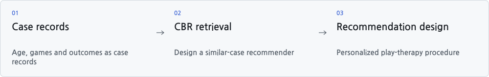
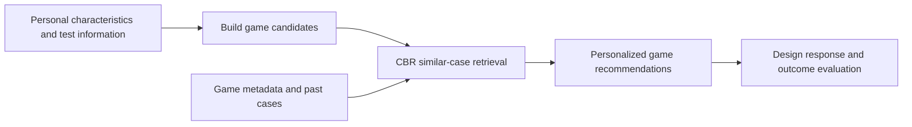

<a name="adhd-청소년-디지털-놀이치료-추천"></a>
<a name="adhd-청소년을-위한-디지털-놀이치료-추천"></a>
<a name="digital-play-therapy-algorithm-for-adhd-adolescent-patients"></a>

<a id="️-adhd-play-therapy-project"></a>

<!-- readme-header32:start -->
<a name="adhd-play-therapy-project"></a>
<p align="center"></p>
<h1 align="center" id="project-title">ADHD Play Therapy Project</h1>
<p align="center">Recommendation design study</p>
<p align="center">
  <a href="../README.md"></a>
  <a href="README.md"></a>
</p>
<p align="center">
  <a href="../docs/%EC%9D%BD%EA%B8%B0%EC%95%88%EB%82%B4/%EB%A0%88%EB%B2%A81.md"></a>
  <a href="../docs/%EC%9D%BD%EA%B8%B0%EC%95%88%EB%82%B4/%EB%A0%88%EB%B2%A82.md"></a>
  <a href="../docs/%EC%9D%BD%EA%B8%B0%EC%95%88%EB%82%B4/%EB%A0%88%EB%B2%A83.md"></a>
  <a href="../docs/%EC%9D%BD%EA%B8%B0%EC%95%88%EB%82%B4/%EB%A0%88%EB%B2%A84.md"></a>
  <a href="../docs/%EC%9D%BD%EA%B8%B0%EC%95%88%EB%82%B4/%EB%A0%88%EB%B2%A85.md"></a>
</p>
<p align="center"><small>LEVEL links open the Korean source at the same reading level.</small></p>
<picture>
  <source media="(max-width: 600px) and (prefers-color-scheme: dark)" srcset="../assets/readme/flow-en-dark-mobile.svg" />
  <source media="(max-width: 600px)" srcset="../assets/readme/flow-en-light-mobile.svg" />
  <source media="(prefers-color-scheme: dark)" srcset="../assets/readme/flow-en-dark.svg" />
  <source media="(prefers-color-scheme: light)" srcset="../assets/readme/flow-en-light.svg" />
  
</picture>
<!-- readme-header32:end -->


This study proposes a method for recommending digital play therapy content using similar past cases.

<!-- reading-levels17:start -->
| Reading level | What the guide covers |
| --- | --- |
| [LEVEL 1 - Beginner (Korean source)](../docs/%EC%9D%BD%EA%B8%B0%EC%95%88%EB%82%B4/%EB%A0%88%EB%B2%A81.md) | Unfamiliar terms and concrete examples from input to result |
| [LEVEL 2 - Explorer (Korean source)](../docs/%EC%9D%BD%EA%B8%B0%EC%95%88%EB%82%B4/%EB%A0%88%EB%B2%A82.md) | The relationships between key concepts and processing steps |
| [LEVEL 3 - Practitioner (Korean source)](../docs/%EC%9D%BD%EA%B8%B0%EC%95%88%EB%82%B4/%EB%A0%88%EB%B2%A83.md) | Experiment and usage procedures, and how to interpret results |
| [LEVEL 4 - Advanced (Korean source)](../docs/%EC%9D%BD%EA%B8%B0%EC%95%88%EB%82%B4/%EB%A0%88%EB%B2%A84.md) | Code structure, settings, design choices, and constraints |
| [LEVEL 5 - Expert (Korean source)](../docs/%EC%9D%BD%EA%B8%B0%EC%95%88%EB%82%B4/%EB%A0%88%EB%B2%A85.md) | Papers, protocols, denominators, leakage, and unverified scope |
<!-- reading-levels17:end -->

Field: Recommender systems › Case-based reasoning › Game recommendations from similar cases

`Paper and research materials` `Document`

[Read the paper](#quick-start) · [Repository structure](#structure) · [Materials and settings](#data)

[Core components](#input-processing-output)

<details>
<summary>Paper title</summary>

Digital Play Therapy Algorithm for ADHD Adolescent Patients

</details>

<a id="-연구-핵심"></a>

## Research overview

This paper presents the design of a CBR-based digital play therapy recommender.

It does not include quantitative results tables or participant and statistical test results that establish clinical effectiveness.

- It describes a CBR structure that retrieves and reuses cases containing adolescents' characteristics and responses to games.
- Personalized recommendations aim to improve cognitive abilities; clinical validation remains future work.

**Materials:** [Final paper (Korean source)](../docs/versions/final-paper.md) · [Complete history (Korean source)](../docs/VERSIONS.md)

<a name="preview"></a>


[Read the published paper](https://www.dbpia.co.kr/journal/articleDetail?nodeId=NODE12025366)

<a name="input-processing-output"></a>

<a id="-입력처리출력"></a>

## Input, processing, and output

| Component | Description |
| --- | --- |
| Problem | How to incorporate adolescents' characteristics and previous responses to games into recommendations. |
| Input | Case information such as age, sex, games, and outcomes |
| Processing | Similar-case retrieval and the design of a CBR recommendation algorithm |
| Output | A procedure for recommending digital play therapy content |

---

<a id="-논문과-최신-자료"></a>

## Paper and current materials

| Material | Original source |
| --- | --- |
| Final paper · ADHD play therapy | [Read the published paper](https://www.dbpia.co.kr/journal/articleDetail?nodeId=NODE12025366) |

[Material descriptions (Korean source)](../docs/PAPERS.md) · [Code revisions and change history (Korean source)](../docs/REVISION_INDEX.md)

<a id="️-차수별-프로젝트-안내"></a>

## All revisions

| Revision or stage | Main content | Materials and comparison with the previous version |
| --- | --- | --- |
| <a id="layout18-table-4-row-1"></a> [Final paper (Korean source)](../docs/versions/final-paper.md) | A design study that stores adolescents' characteristics and game responses as cases, then uses similar cases to recommend digital play therapy games. | [Folder](../%EB%85%BC%EB%AC%B8)<br>[Full comparison (Korean source)](../docs/VERSIONS.md) |


<a id="-프로젝트-소개"></a>

## Research method

Authors: **곽윤석 · 김도연 · 박정수 · 안진호** (names as credited in the paper)

Proceedings of the 2024 Fall Conference of the Korean Institute of Information Technology, printed pages 1727–1729.

| Component | What the paper covers |
| --- | --- |
| Case structure | Proposed case fields include age and sex, game types and play records, and cognitive outcomes. |
| Similar-case retrieval | A new user's characteristics are compared with existing cases to find a basis for recommendations. |
| Recommendation flow | Game candidates and metadata are combined to select games for each individual. |
| Evaluation design | A procedure is proposed for evaluating changes in cognitive ability after recommendations. |



<a name="structure"></a>
<a id="-저장소-구성"></a>

## Repository structure

```text
.
├── README.md
├── CHANGELOG.md
└── 논문/
    └── 최종_논문.pdf
```

- [Read the published paper](https://www.dbpia.co.kr/journal/articleDetail?nodeId=NODE12025366)

<a id="-사례-기반-추천의-구성"></a>

## Structure of case-based recommendations

Page 2 explains the sequence of case collection → similarity evaluation → case retrieval → recommendation → result evaluation. The system diagram connects MMSE test results, game candidate generation, the CBR recommendation model, and game metadata.

The paper does not provide a specific similarity formula or an executable recommender implementation.

<a name="quick-start"></a>
<a id="-원고-읽기"></a>

## Reading the paper

1. Open the final paper linked above.
2. Start with the research question and method in the introduction.
3. Review the algorithm diagram and the limitations and future work in the conclusion. This paper has no quantitative results table.

The research paper describes the design and processing flow of a CBR-based recommender for digital play therapy content.

<a name="data"></a>
<a id="-자료-구성과-결과-해석"></a>

## Materials and interpretation

The study focuses on case fields and the recommendation procedure. Actual patient records and game usage logs are not included.

<a name="원고가-보고한-결과와-한계"></a>

<a id="-원고가-보고한-결과와-한계"></a>

### Reported results and limitations

The starting point is to find suitable games for individuals among games intended to train memory and attention. The paper proposes collecting characteristics and game responses from ADHD patients and a normal control group as cases, but it provides no collected sample or case dataset.

CBR-based personalization is intended to support cognitive improvement. This is a recommendation-system design study; validating treatment effects through pre/post assessment of clinical participants and controls, together with statistical tests, remains future work.

<a id="-문제-해결"></a>

## Questions and checks

| Situation | What to check |
| --- | --- |
| There is no program to run directly. | The paper is the main material in this repository.<br>See it for the research method and design. |
| You are looking for treatment-effect measurements. | The paper proposes a recommendation algorithm and provides no clinical effect measurements. |
| The 2025 folder and the paper year differ. | The conference year in the paper header is 2024.<br>It is distinct from the archive folder year. |

<a id="️-자료-폴더와-차수별-변화"></a>

## Material folders and revision changes

| Material | Folder | Description and comparison or structure |
| --- | --- | --- |
| Final paper | [Material folder](../%EB%85%BC%EB%AC%B8) | [Content (Korean source)](../docs/versions/final-paper.md)<br>[Comparison and structure (Korean source)](../docs/VERSIONS.md) |

<a id="-현재-첨부-문서"></a>

## Current documents and change history

These are the current originals and their comparison with the previous public version. Earlier papers, presentations, and code can be found in the all-revisions table.

| Document | Material folder | Details and full comparison with the previous public version |
| --- | --- | --- |
| Final paper · ADHD play therapy | [Folder](../%EB%85%BC%EB%AC%B8) | [Description (Korean source)](../docs/latest/adhd-cbr-design.md)<br>[Full comparison (Korean source)](../docs/changes/2026-11-02-%EC%B5%9C%EC%8B%A0%EB%AC%B8%EC%84%9C-%EC%A0%84%EC%B2%B4%EB%B9%84%EA%B5%90.md) |

[Changes to the current document structure (Korean source)](../docs/changes/2026-11-02-%EC%B5%9C%EC%8B%A0%EB%AC%B8%EC%84%9C.md)

<a name="research-details"></a>

<a id="-연구구현의-세부-흐름"></a>

## Methods and conditions by revision

Inputs, processing methods, execution conditions, and results are organized by revision.

<a id="️-최종-원고--사례로-찾는-디지털-놀이치료"></a>

<details>
<summary>Final paper · Finding digital play therapy through cases</summary>

<a id="최종-원고--사례로-찾는-디지털-놀이치료"></a>

A design study that stores adolescents' characteristics and game responses as cases, then uses similar cases to recommend digital play therapy games.

| Component | Processing |
| --- | --- |
| Case structure | User characteristics such as age and sex are connected with game types, responses, and outcomes in a single case. |
| Case retrieval | Past cases suited to a new user's characteristics are retrieved as the basis for recommendations. |
| Game candidates | The flow selects suitable content using game metadata and previous responses. |
| Post-recommendation evaluation | The design observes responses and cognitive outcomes after play and feeds them into subsequent recommendations. |

| Input or condition | Description |
| --- | --- |
| Material | The complete 3-page paper in the conference proceedings |
| Reading tool | A PDF viewer |
| Case fields | Age, sex, game type, and usage responses, among others |
| Evaluation scope | A proposed recommendation structure and evaluation procedure |

The result is the design and processing flow of a recommender system. The paper provides no quantitative performance table or clinical effects established through participant counts, control-group comparisons, and statistical tests.

Improving memory and attention is a design objective.

Collecting actual user responses and evaluating recommendations requires a separate empirical study with privacy safeguards and research procedures. The paper's objectives should not be interpreted as measured treatment effects.

| Constraint | What to check |
| --- | --- |
| Running recommendations directly | A similarity formula, training data, and an executable recommendation service are not included. |
| Checking the paper year | The conference year stated in the paper is 2024.<br>It is distinct from the year used to archive files on the computer. |
| Citing effect measurements | This is a design proposal and provides no quantitative pre/post-treatment experiment results. |

[Files, key definitions, and reading order (Korean source)](../docs/versions/final-paper.md) · [Full comparison for this stage (Korean source)](../docs/VERSIONS.md)

[Changes to the revision guides (Korean source)](../docs/changes/2026-11-03-%EC%B0%A8%EC%88%98%EB%B3%84%ED%94%84%EB%A1%9C%EC%A0%9D%ED%8A%B8%EC%95%88%EB%82%B4.md)

</details>
